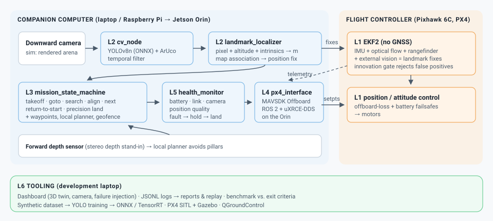

# GPS-Denied Drone Navigation: Digital Twin

A complete software-in-the-loop simulation of the GPS-denied waypoint-navigation drone from
*GPS_Denied_Drone_POC_Ideation_and_Phase_Plan* (Draft v1). The simulation runs the code that will
later run on the real companion computer:

- a downward camera, rendered from a simulated arena, feeds a custom-trained **YOLOv8n landmark
  detector** (ONNX) and **OpenCV ArUco** anchors;
- a **landmark localizer** turns pixels into metres and corrects the drift of a **PX4 EKF2-style
  estimator** that runs on optical flow, a rangefinder and the IMU, with **no GPS anywhere**;
- a **mission state machine** (TAKEOFF → GOTO_WAYPOINT → SEARCH_LANDMARK → ALIGN → NEXT_WAYPOINT →
  RETURN_TO_START → PRECISION_LAND → LAND) streams Offboard setpoints;
- a **health monitor** runs the failsafe chain (fault → hold → land), and a reactive **local planner**
  steers around obstacles;
- everything is shown live in a **browser dashboard** with a 3D view, the onboard camera with AI
  detections, accuracy against ground truth, and one-click **failure injection**.

The same mission code drives **real PX4** (SITL with Gazebo, or a Pixhawk) through MAVSDK. The
`--px4` path below is the bridge from simulation to the drone.



---

## 1. Quick start (5 minutes)

**Requirements:** Python 3.10–3.13 on Windows, macOS or Linux, and a modern browser. No GPU needed.

```bash
git clone <this repo> && cd Drone-proto

# Linux / macOS
./scripts/setup.sh
source .venv/bin/activate

# Windows (PowerShell)
.\scripts\setup.ps1
.\.venv\Scripts\activate
```

Start the investor demo:

```bash
python scripts/run_dashboard.py --open      # opens http://localhost:8080
```

Press **▶ Start mission**. The drone arms, takes off, flies to four landmarks without GPS, avoids
three pillars, aligns over each landmark with AI detection, returns home and lands on the helipad.

Useful options:

| Command | What it does |
|---|---|
| `python scripts/run_dashboard.py --speed 2` | Run at 2× real time (also selectable in the UI) |
| `python scripts/run_dashboard.py --mission hello_square` | Phase 0 "hello waypoint" mission |
| `python scripts/run_dashboard.py --host 0.0.0.0` | Show it on a TV, tablet or second laptop on the same network |
| `python scripts/run_dashboard.py --autostart` | Start flying immediately |

### What to show investors on the dashboard

1. **Vision correction.** The *Navigation accuracy* panel compares the onboard estimate with
   ground truth. The orange line is what optical flow and the IMU alone would do (dead reckoning);
   the blue line is the estimate with AI landmark correction.
2. **AI perception.** The onboard camera panel shows YOLO boxes and decoded ArUco tags, the metric
   offset of each landmark, and whether the estimator *accepted* or *rejected* the fix.
3. **Failure injection.** Click *Camera covered* during an alignment (hold, then resume), *Companion
   link lost* (the PX4 offboard-loss failsafe triggers, then the mission recovers), *Battery drops to
   22 %* (return to start), *Inject false-positive detections* (the estimator's innovation gate
   rejects them), or *Strong wind gust*.
4. **Vision correction toggle.** Uncheck *Vision correction* in the top bar and run again to show the
   drone drifting off target without the AI.

A step-by-step talk track is in [docs/DEMO_SCRIPT.md](docs/DEMO_SCRIPT.md).

---

## 2. Everything else you can run

```bash
# Headless mission, prints the state machine and a metrics summary
python scripts/run_sim.py
python scripts/run_sim.py --no-correction                          # dead reckoning only
python scripts/run_sim.py --inject camera_covered@14:4 --inject wind_gust@20:15
python scripts/run_sim.py --record demo.mp4                        # video for the pitch deck

# Every run writes logs/<mission>_<time>.jsonl (common log format, plan section 5)
python scripts/make_report.py --latest                             # HTML + PNG flight report
python scripts/replay_log.py logs/<file>.jsonl                     # replay a flight in the dashboard

# Exit-criteria test campaign (P0 square x5, P2 missions x3, ON/OFF comparison, failsafe matrix)
python scripts/benchmark.py            # writes docs/benchmark_results.md
python -m pytest -q                    # unit + end-to-end mission tests
```

Fault names for `--inject NAME@START[:DURATION]`: `camera_covered`, `camera_dropout`, `dim_lights`,
`link_loss`, `featureless_floor`, `wind_gust`, `low_battery`, `false_landmark`.

---

## 3. The AI model

| Model | Role | Where |
|---|---|---|
| **YOLOv8n landmark detector**, custom-trained | Detects `helipad`, `pad_red`, `pad_blue`, `cross_yellow`, `aruco_tag` | `models/landmarks_yolov8n.onnx` (ships with the repo) |
| YOLOv8n COCO (open-source, Ultralytics) | Pretrained starting point (transfer learning) | `python scripts/download_models.py` |
| OpenCV ArUco (DICT_4X4_50) | Non-ML anchors, decoded IDs, heading fix | built in |
| HSV colour segmentation | CPU-only fallback if no model is present | built in |

The detector was trained on **synthetic, automatically labelled images rendered by the simulator
itself**: random floors, lighting, height, tilt, motion blur, JPEG artefacts and painted distractors.
Evaluation on the held-out split is stored in `models/landmarks_yolov8n.json`. To regenerate it:

```bash
pip install -r requirements-train.txt                 # PyTorch + Ultralytics
python scripts/generate_dataset.py --train 1600 --val 300
python scripts/train_landmark_model.py --epochs 30    # CPU ok (~1 h); add --device 0 on an NVIDIA GPU
```

Before flying the real drone, add real images captured at flight height to the dataset (plan
section 8). See [docs/ML.md](docs/ML.md) for the dataset plan, temporal filtering, the licence note
(Ultralytics is AGPL-3.0) and Jetson TensorRT export.

---

## 4. From simulation to the real drone

The mission, perception and safety code talk to the vehicle through one interface
(`gdnav/interface/vehicle.py`). Swapping the built-in simulator for PX4 is a command-line change.

**PX4 SITL (Phase 0/1, Ubuntu 22.04):**

```bash
./scripts/px4_sitl.sh setup        # one time: PX4 v1.17.0 + Gazebo toolchain
./scripts/px4_sitl.sh run          # gz_x500_flow: quadcopter with optical flow + rangefinder
# second terminal
pip install -r requirements-px4.txt
python scripts/apply_px4_params.py # config/px4/gps_denied_flow.params (GPS off, flow on, failsafes)
python scripts/run_px4.py --mission hello_square
```

**Pixhawk 6C on the bench (props OFF), then tethered:**

```bash
python scripts/apply_px4_params.py --url serial:///dev/ttyACM0:921600
python scripts/run_px4.py --url serial:///dev/ttyACM0:921600 --mission plan_example --camera 0
```

Landmark fixes go to PX4's EKF2 as MAVLink `VISION_POSITION_ESTIMATE` (`EKF2_EV_CTRL`), the same
path VIO will use in Phase 3. Phase 3 material for the Jetson (VIO bridge with ENU/FLU → NED/FRD
conversion, TensorRT engine builder) is in [jetson/README.md](jetson/README.md).

> **Safety (plan section 12):** props off for all bench work, a tether for first hovers, and an RC
> transmitter with a kill switch in a trained pilot's hands on every flight. No payloads or targeting
> functions are part of this project.

---

## 5. Repository map

```
gdnav/
  sim/           world + floor texture, downward camera renderer, quadrotor physics, sensors
                 (IMU, flow, rangefinder, baro, mag, depth), EKF2 analogue, PX4 controller analogue
  perception/    cv_node, YOLO (ONNX) + ArUco + colour detectors, landmark_localizer, temporal filter
  navigation/    mission files + waypoint_manager, mission_state_machine, local_planner, geofence
  safety/        health_monitor (failsafe chain)
  interface/     VehicleInterface, PX4 MAVSDK backend
  bridge/        ENU/FLU <-> NED/FRD frames for the VIO bridge
  dashboard/     ground dashboard (stdlib HTTP server + three.js)
  tools/         flight report, replay, demo video
  runner.py      the companion main loop (perception -> estimator -> health -> state machine)
config/          sim.yaml (all rates, noise, gains, thresholds), px4/ parameter set
worlds/          arenas: landmarks, obstacles, distractors
missions/        mission files (format from plan section 9)
models/          trained landmark detector (ONNX + PyTorch + eval report)
scripts/         run_dashboard, run_sim, benchmark, dataset/train/export, PX4, reports
jetson/          Phase 3: ROS 2 VIO bridge, notes
tests/           pytest suite
docs/            architecture, demo script, ML notes, benchmark results
```

How each module of the plan (section 7) maps to code: [docs/ARCHITECTURE.md](docs/ARCHITECTURE.md).

### Changing the scenario

- **New route:** copy `missions/investor_demo.yaml` and edit the waypoints (metres from takeoff, local
  NED: x = north, y = east).
- **New arena:** copy `worlds/indoor_arena.yaml`. Move landmarks, add pillars, change `surface:
  grass` for an outdoor look. The floor texture is regenerated automatically.
- **Tuning:** every rate, noise level, gain and threshold is in `config/sim.yaml`. For harsher
  conditions, override it: `python scripts/run_sim.py --config my_overrides.yaml`.

---

## 6. What is simulated, and what is not

This is an engineering digital twin, not a photorealistic game engine:

- The **camera image is real pixels**, rendered geometrically from the arena floor (homography,
  vignetting, noise, motion blur). Detectors run on it exactly as on a real camera; lighting and
  materials are simplified.
- **Flight dynamics, EKF and PX4 control are analogues** with PX4's structure and parameter names,
  not the PX4 firmware itself. Use the PX4 SITL path (section 4) to validate against real PX4.
- **Sensor noise and biases are representative** (flow scale error, magnetometer bias, accel bias
  random walk). Measure the real sensors and update `config/sim.yaml`.
- The obstacle sensor is a ray-cast depth fan standing in for stereo depth; the local planner is a
  reactive stand-in for EGO-Planner with the same velocity-in/velocity-out interface.
- Metrics marked *true / reach / RTS error* use simulator ground truth (the "measured floor grid" of
  the plan). On the real drone, measure them with the floor grid or motion capture.
